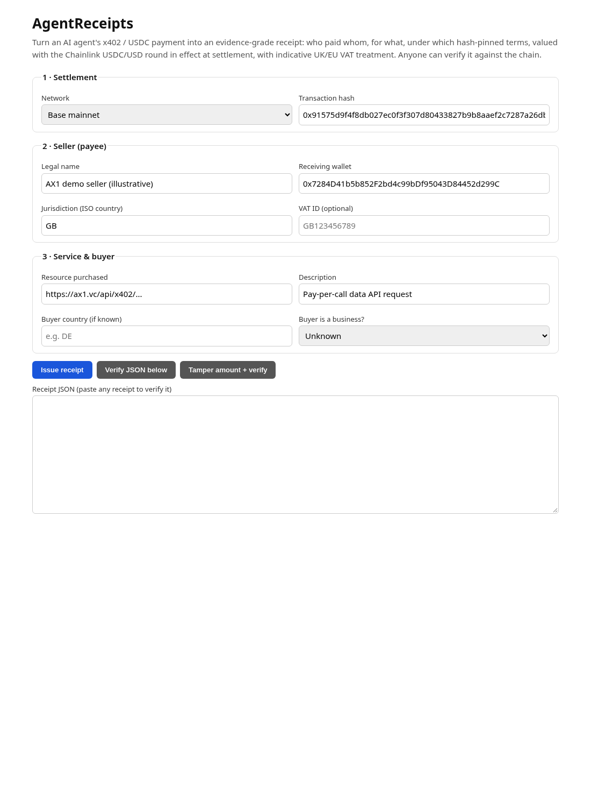
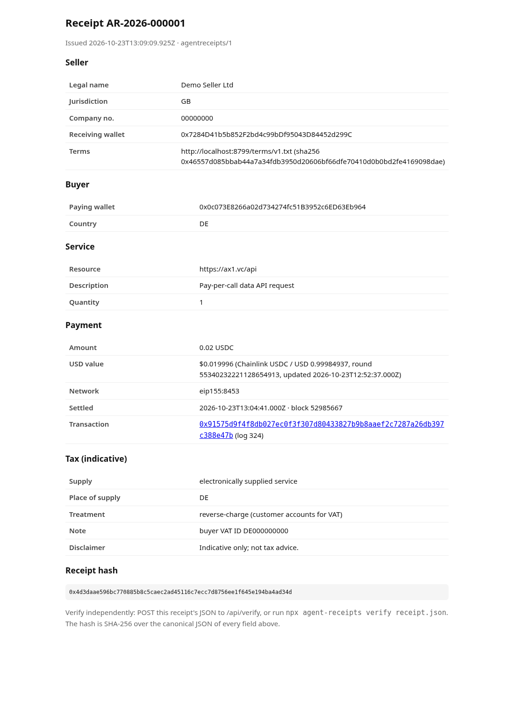

# AgentReceipts

**Evidence-grade receipts for AI-agent stablecoin payments.** AgentReceipts turns an x402 or plain USDC payment on Base into a receipt that a bookkeeper, auditor, tax authority or court can rely on. Each receipt carries:

- **Parties.** Payer and payee come from the on-chain `Transfer` log. The seller's legal identity and the buyer agent or operator are added on top.
- **Terms.** The exact terms version the agent accepted, pinned by SHA-256.
- **Fiat value.** The value at the time of supply, from the **Chainlink USDC/USD Data Feed** round in effect at the settlement block.
- **Tax.** Indicative UK/EU VAT place-of-supply treatment (reverse charge, OSS, UK digital services, evidence needed).
- **Tamper-evidence.** A canonical SHA-256 `receiptHash`, plus an optional on-chain anchor in `ReceiptRegistry.sol`, which reads Chainlink itself.
- **Independent verification.** Every claim is re-derived from Base and Chainlink. No trust in the issuer is needed, and verification needs no archive node.

Built for BLI Legal Tech Hackathon 2 (Chainlink track).




## Quick start
```bash
npm ci
npm run demo        # issues + verifies a receipt for a real Base mainnet x402 payment, then shows two forgery attempts failing
npm run dev         # web UI at http://localhost:8787
npm test            # 20 unit/integration tests (mocked chain)
npm run test:live   # + real Base mainnet round-trip via the HTTP API
npm run test:contracts && npm run test:fork   # Foundry: 7 unit tests + live Chainlink feed fork test
```

## CLI
```bash
npx tsx src/cli.ts issue --tx 0x… --payto 0x… --seller "Acme Ltd" --country GB --buyer-country DE --out r.json
npx tsx src/cli.ts verify r.json        # exit code 0 = valid
```

## For x402 sellers
```ts
import { receiptFromSettlement, termsExtension } from "agent-receipts/x402";
// advertise terms in the 402 offer: extensions: termsExtension(TERMS_URL, TERMS_SHA256)
server.onAfterSettle(async ({ result, requirements, paymentPayload }) =>   // @x402/core >= 2.28
  store.save(await receiptFromSettlement(result, requirements, paymentPayload.resource, seller, nextInvoiceNo())));
```

## API
| Method | Path | |
|---|---|---|
| POST | `/api/receipts` | `{ txHash, network?, logIndex?, seller{legalName,address,jurisdiction,vatId?,companyNumber?}, buyer{country?,businessCustomer?,vatId?,agentId?}, service{resource,description} }` → `201 { receipt, url }` |
| GET | `/api/receipts/:hash` | receipt JSON |
| GET | `/r/:hash` | printable receipt |
| POST | `/api/verify` | receipt JSON → `{ valid, checks[] }` |
| GET | `/terms/v1.txt` | hash-pinned agent-purchase terms |

## Example
[`examples/receipt-ax1-base-mainnet.json`](examples/receipt-ax1-base-mainnet.json) is a real 0.02 USDC x402 payment to a live Bazaar API on Base mainnet (tx `0x91575d9f…e47b`), valued at Chainlink round `55340232221128654913` (0.99984937 USD).

See [docs/ARCHITECTURE.md](docs/ARCHITECTURE.md) for design, verification logic and limits.

## Disclosure
Built with AI coding assistance. Tax output is indicative and is not tax or legal advice. The demo seller identity is illustrative.

MIT licensed.
