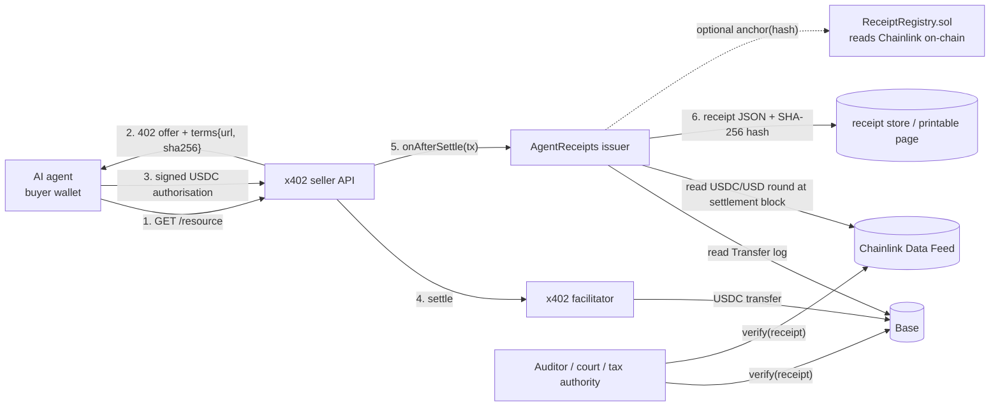

# AgentReceipts architecture

## Components
| Path | Role |
|---|---|
| `src/receipt.ts` | Build and verify receipts. Reads the USDC `Transfer` log from the settlement tx (payer, payee, amount, block, log index), the block timestamp and the Chainlink USDC/USD round. Verification needs no archive node: it proves the claimed round was in effect at settlement with `getRoundData(round)` (published before settlement) and `getRoundData(round+1)` (absent, or published after settlement). |
| `src/canonical.ts` | Canonical JSON (sorted keys) plus SHA-256 → `receiptHash`. Any edit to any field changes the hash. |
| `src/tax.ts` | Indicative UK/EU place-of-supply logic for electronically supplied services: reverse charge, EU OSS destination VAT, UK VAT from the first £ for non-established sellers, and "location evidence required" when the buyer is only a wallet. |
| `terms/agent-terms-v1.txt` | Machine-readable agent-purchase terms (contract formation at settlement, agency, refunds, records clause). Its SHA-256 goes in the 402 offer and in every receipt. |
| `src/x402.ts` | Adapter: x402 `SettleResponse` → receipt, plus a `termsExtension()` for the 402 offer. |
| `src/server.ts` | Web UI and REST: `POST /api/receipts`, `GET /api/receipts/:hash`, `GET /r/:hash` (printable), `POST /api/verify`, `GET /terms/v1.txt`. |
| `contracts/src/ReceiptRegistry.sol` | Optional public anchor. It stores the receipt hash against the settlement (tx, logIndex) and reads Chainlink `latestRoundData` on-chain, rejecting stale or invalid answers. One live receipt per settlement (no double receipting). The seller can revoke and reissue (e.g. after VAT evidence arrives), and the history stays public. |

## Verification checks
`version`, `receipt_hash`, `settlement_tx`, `payer`, `payee`, `amount`, `block`, `oracle_round`, `usd_value`, plus `terms_hash` when the terms URL is fetched.
An attacker who edits a field and recomputes the hash still fails, because the values are re-derived from Base and Chainlink.

## Why this is a legal-tech problem
Agentic payments (x402, Coinbase/Cloudflare; ERC-8004 agents) settle millions of sub-dollar purchases with no invoice, no identified counterparty and no agreed terms. Bookkeepers, auditors and tax authorities need, per transaction:
- **The parties and the agency relationship.** The agent acts for its operator.
- **The contract terms actually accepted.** Terms are pinned by hash, so later edits are detectable.
- **The fiat value at the time of supply.** This comes from a Chainlink round proven on-chain, not a seller-chosen rate.
- **The VAT place of supply.** Evidence requirements are flagged.
- **Tamper-evidence and independent verification.**

## Limits (honest)
- Tax output is indicative, not advice. Rates cover a subset of countries.
- Issuing a receipt for an old payment needs an archive RPC (`BASE_RPC_URL`) for the historical `latestRoundData` read. Verification does not.
- Buyer identity is a wallet address unless the agent supplies ERC-8004 identity or VAT details.
